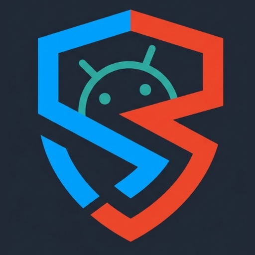

<div align="center">
  
  <h1>SHE: Sentinel for Handheld Equipment</h1>
  <p><strong>Open-Source Anti-Theft, Real-Time Handset Recovery & Zero-Knowledge Defense Ecosystem</strong></p>

  [](LICENSE)
  [](https://android.com)
  [](#zero-telemetry-guarantee)
  [](RELEASES.md)
  [](docs/DATA_PRIVACY.md)
</div>

---

## 📥 Direct APK Downloads (v0.3.0)

Download the verified binaries directly from this release repository:

| App | Description | Size | Download Link | SHA-256 Checksum |
| :--- | :--- | :--- | :--- | :--- |
| **SHE Guardian** | Install on the handset to be protected | 33.7 MB | [⬇️ Download `she-guardian.apk`](releases/she-guardian.apk) | `f43a804f84fa92d54a6d7a07eb625dac9c8627ee7670abd3c67b3fa17e03b037` |
| **SHE Admin Companion** | Install on the owner's controller phone | 31.0 MB | [⬇️ Download `she-admin.apk`](releases/she-admin.apk) | `3fafa29182a74b648109d2f225ab652e5c677042d9fa5f063ef3fc42a131b59a` |

> 🌐 **Interactive Web Release Portal**: You can also open [`index.html`](index.html) in any web browser to view the interactive release dashboard with one-click download buttons, mobile QR codes, and telemetry guides.

---

## 🛡️ Quick Installation & Verification

### 1. Cryptographic Checksum Verification
Before sideloading onto your Android hardware, verify that the files are untampered:
```bash
# Verify checksums using sha256sum
cd releases
sha256sum -c checksums.sha256
```
*Expected Result*: `she-guardian.apk: OK` and `she-admin.apk: OK`.

### 2. Sideloading onto Android Handsets
1. **Enable Unknown Apps**: When opening the APK, tap **Settings** $\rightarrow$ Toggle **"Allow from this source"** ON $\rightarrow$ Tap **Install**.
2. **Google Play Protect Notice**: If Play Protect prompts *"Blocked by Play Protect"*, tap **"More details"** $\rightarrow$ **"Install anyway"** (SHE uses privileged Device Administrator APIs outside Google Play).
3. **Android 13+ "Restricted Settings" Bypass**: 
   * Navigate to **Settings** $\rightarrow$ **Apps** $\rightarrow$ **SHE Guardian**.
   * Tap the **Three Dots (⋮)** in the top-right corner $\rightarrow$ tap **"Allow restricted settings"**.
   * Authenticate with your fingerprint or PIN, then activate Device Administrator inside the app.
4. For complete manufacturer-specific battery and autostart configuration (Xiaomi HyperOS, Samsung One UI, OnePlus), read the [Installation Guide](docs/INSTALLATION_GUIDE.md).

---

## ⚡ Core Capabilities

* **🗺️ One-Click Map Search**: Instant **"Search on Map"** buttons on both handset and companion screens that open satellite coordinates directly in Google Maps (`geo:<lat>,<lng>?q=...`).
* **🛰️ Direct Boot Telemetry**: Resumes encrypted GPS tracking immediately after device power-on, even while the phone remains locked at the first boot screen before user PIN entry.
* **📶 Offline AT1 SMS Fallback**: Transmits 48-bit truncated HMAC-SHA256 authenticated emergency location beacons over standard SMS when cellular data and Wi-Fi are unavailable.
* **🔐 Zero-Knowledge Vault**: Stores emergency master passphrases encrypted client-side using Argon2id and AES-256-GCM. The server holds zero readable secrets.
* **📷 Mutual QR Camera Pairing**: Establishes secure device binding via optical camera scanning without exposing pairing tokens over public networks.
* **🔊 Emergency Acoustic Siren**: High-pitch auditory alert controllable remotely to pinpoint a misplaced or hidden phone.

---

## 🔒 Safety & Zero-Harm Guarantees

* **Zero Harm to Personal Devices**: SHE contains **no bricking, no destructive storage corruption, and no forced factory wipes**. All commands preserve operating system integrity and personal data.
* **Zero Automated Emergency Interference**: SHE **never dials 112, 911, or emergency dispatchers automatically**. All emergency assistance references are purely user-facing documentation.
* **Indian ERSS 112 & CEIR Compliant**: Designed to work harmoniously alongside the national emergency system and Department of Telecommunications Sanchar Saathi portal ([sancharsaathi.gov.in](https://sancharsaathi.gov.in)).

---

## 📚 Documentation
* [📖 User Guide](docs/USER_GUIDE.md) - Handset features, pairing steps, and dashboard operations.
* [📲 Sideloading Runbook](docs/INSTALLATION_GUIDE.md) - Android 10-15 installation and OEM optimization.
* [⚙️ Setup Runbook](docs/SETUP_ORDER.md) - 10-step deployment and verification runbook.
* [🔐 Data Privacy & Compliance](docs/DATA_PRIVACY.md) - Zero-telemetry technical disclosure.

---

## 📄 License
SHE is open-source software licensed under the [Apache 2.0 License](LICENSE).
